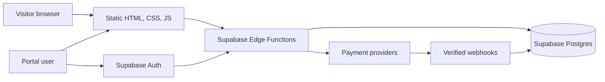

# Sow Your Seed Here — Master Document

**Project:** Sow Your Seed / Seed Garden

**Document date:** 28 October 2026

**Source of truth for this document:** the files in this repository at the time of writing. This describes implemented code and content, not a verified production deployment. Payment destinations and links are intentionally omitted.

## 1. Site at a glance

Sow Your Seed Here is a faith and spirituality themed site centered on “sowing” a seed in support of its content. Its public home screen combines a seed checkout, a ritual offering, a recent transaction board, a progress display, and messaging about love, prayer, hope, and spiritual guidance. The same repository also contains a personalised digital writing service, an ebook catalog, a community Blessing Wall, and staff portals for orders and reporting.

The site is a static HTML, CSS, and JavaScript frontend backed by Supabase. Supabase provides data storage, authentication, access control, and Edge Functions. Dodo Payments and PayPal are the implemented payment providers. All displayed prices are in US dollars. The default seed price in current code and the latest price migration is **$11 per seed**; an Admin can change the saved seed price.

## 2. Audience and roles

| Role | Main experience |
| --- | --- |
| Public visitor | Read the home content, choose seeds, view the progress display and recent public transactions, browse ebook entries where accessible, and open the checkout or ritual forms. |
| Customer | Provide name, email, and applicable request details; complete a checkout; receive a confirmation and fortune message after a verified payment. |
| Admin | Sign in, see Admin collection orders, update fulfillment, download order proof PDFs, manage the seed price and Blessing Wall visibility, and view Admin scoped analytics. |
| SuperAdmin | Sign in, see SuperAdmin collection orders and analytics, use the private PayPal checkout area, and control which checkout form appears on Home. |
| Standard | Sign in to a read only calendar of successful public Admin routed transactions, with customer names and amounts. |

Portal access is based on Supabase Auth plus the `admin_profiles` role. The public interface does not grant portal privileges by itself.

## 3. Public site map and content

| Area or file | Purpose and current behavior |
| --- | --- |
| `index.html` / Home | Main landing page with branding, seed checkout, ritual card, hero image, recent transaction board, progress display, spiritual support copy, sharing action, and portal login button. |
| `libraryView` in `index.html` | “Christgarden EBooks” catalog with 21 covers and entries across three series. Clicking an entry opens a preview dialog. |
| `aboutView` in `index.html` | Recent custom orders, expandable personalised writing description, and community Blessing Wall. |
| `privacy-policy.html` | Standalone privacy policy page. |
| `delivery-fulfillment-policy.html` | Standalone policy for digital delivery and fulfillment. |
| `sow-your-seed.html` | Immediate redirect to `index.html`. |

**Navigation note:** The frontend code supports section tabs for Home, Library, and About, but the current `index.html` does not contain elements with `data-section-tab`. Library and About are present as hidden sections, so their direct discoverability should be checked before describing them as reachable public pages.

### Home

- The header shows the Sow Your Seed Here brand and a menu button that opens portal login.
- The seed control starts at one seed and adjusts the count before checkout. The normal starting amount is $11. The public form shown on Home depends on the SuperAdmin checkout display setting.
- The hero image shows a sower in a sunlit landscape. A recent transaction board displays eligible public Admin routed transactions. The goal card shows progress toward 100 seeds using confirmed seed payments; the backend uses a $1,100 cycle.
- The story and About Sowing Your Seed sections describe support as optional and connect the site to soulmate messages, spiritual guidance, Jesus, and Archangel Michael. The share button uses device sharing where available and otherwise copies the page address.
- The footer displays Proverbs 18:22.

### Rituals

The Home ritual card has four selectable tiers displayed at **$199, $299, $399, and $499**. A visitor selects a tier, enters a name, email, and “who is this ritual for” message, then proceeds through the active payment provider. The code records ritual payments separately from seed progress and seed comments. The labels in the public card and the internal item names differ; see the review notes below.

### Ebook catalog

The catalog contains these three series:

| Series | Number of entries | Free local PDF currently present |
| --- | ---: | --- |
| The Stories We Leave Behind | 10 | *A Kitchen Full of History* |
| Of Little Things & Passing Days | 7 | *A Map of Small Kindnesses* |
| Whispers of Grace | 4 | *A Prayer Between Seasons* |

Each ebook entry has a cover, title, seed cost, summary, and description. The first entry in each series opens its local PDF in the preview dialog and offers a download when the file is available. Other entries show catalog and preview information; their Get control explains a seed based acquisition process. The current frontend does not complete an ebook purchase or deliver those other titles directly. Historical ebook orders and related fulfillment fields remain in the backend.

### About and Blessing Wall

The About section describes personalised writing prepared from a customer's prayer, intention, or message and delivered by email. It also contains recent custom orders and community comments. The Blessing Wall can be shown or hidden by an Admin. Backend filtering includes legacy comments and eligible comments linked to public, verified orders.

## 4. Customer journeys

### Seed order

1. The visitor chooses a seed count. The displayed total uses the saved seed price.
2. The visitor opens the active checkout form and supplies the required customer details.
3. An Edge Function creates a provider checkout or order and records the attempt.
4. After payment, the browser returns or receives provider approval. A server function verifies the provider result; webhooks also process completed payments.
5. A confirmed payment creates one linked digital service order. The site shows a confirmation and fortune message. Eligible public data can appear in the transaction board, goal, and Blessing Wall.

The Dodo flow is routed to Admin collection. New PayPal orders use SuperAdmin collection. Existing Admin PayPal records remain visible in Admin history. Checkout cancellation or failure opens a retry message. Duplicate confirmations and webhook deliveries are designed to avoid duplicate orders.

### PayPal weekly plan

When the PayPal checkout is active, the customer can choose a weekly subscription. The initial amount is charged at signup as a setup fee. Subsequent payments are scheduled for Mondays at 7:30 AM India time, with completed charges linked to orders. The one time path remains available when the weekly option is off.

### Personalised writing fulfillment

Verified payments create a digital service order for personalised writing. The relevant collection portal shows order details and the customer's request. Staff can mark an order fulfilled with a date and time and download a proof PDF. Delivery is described as electronic, generally by email. The site does not itself show an automated writing generation or email delivery implementation.

## 5. Staff portal behavior

The portal is opened from the header and requires a signed in Supabase user with a supported role.

- **Admin:** order calendar, order details, fulfillment action, proof PDF download, seed price, Blessing Wall visibility, and Admin checkout analytics. The calendar retains older Admin PayPal orders alongside Admin Dodo orders.
- **SuperAdmin:** separate collection calendar, private PayPal checkout section, checkout display settings, and SuperAdmin scoped analytics. Display settings choose the Home checkout provider and can enable a separate card option.
- **Standard:** read only monthly calendar for successful public Admin routed transactions. It shows names and amounts, without order management controls.

Admin and SuperAdmin analytics include page visits, checkout starts, completed payments, and payment attempt details. They share the total page visit count but keep payment activity scoped to their own collection route. Each portal has its own analytics reset point.

## 6. Data and system architecture

The frontend is served directly from `index.html`; there is no frontend build step. `src/app.js` owns most state, rendering, portal, and PayPal behavior. `src/home-dodo-checkout.js` handles the Home Dodo form and return confirmation. `src/home-books-carousel.js`, `src/shop-gallery.js`, and `src/book-preview.js` manage the ebook presentation. `src/styles.css` and `src/legal.css` provide styling. `src/config.js` contains public browser configuration; server credentials belong in Supabase secrets.

Important database areas include `admin_profiles`, `site_settings`, `donations`, `digital_orders`, `payment_attempts`, `checkout_events`, `page_views`, `seed_comments`, subscription tables, and provider webhook event tables. Migrations in `supabase/migrations/` are the schema history. Row level security and role checks are part of the backend access model.

The active Edge Functions cover public bootstrap and transactions, checkout creation and confirmation, provider webhooks, portal profile and settings, Admin orders, subscriptions, analytics, Standard transactions, and checkout event tracking. The deploy script in `package.json` is the authoritative function list for this repository.

## 7. Operation and local development

1. Install dependencies with `npm install`.
2. Set public Supabase values in `src/config.js`. `src/config.example.js` is the template. The repository currently has backend mode enabled.
3. Set server credentials as Supabase Edge Function secrets using `.env.example` as a field list. Never place server secrets in the browser config or this document.
4. Apply database migrations with `npx supabase db push` after linking the intended Supabase project.
5. Run the local static server with `npm run dev` and open `http://127.0.0.1:5173`.
6. Run `npm run check` before deployment. Deploy functions with `npm run supabase:deploy` when intended.

The repository includes Node tests for integrity, checkout security, Dodo, ritual checkout, public transactions, weekly subscriptions, the Standard portal, and SuperAdmin behavior. Use provider test environments for checkout verification.

## 8. Current review notes

These are differences or gaps visible in the repository, not claims about production status:

1. **README pricing is stale.** It still mentions a $7 seed and older ebook groupings. Current frontend defaults and the latest migration use $11 per seed and the current catalog is 10/7/4 entries.
2. **Legal copy needs a payment method review.** The privacy policy says payments are processed through PayPal, while the current site also implements Dodo checkout.
3. **Library and About discoverability needs review.** Their sections exist, but current markup has no section tab elements to switch to them. The homepage carousel script also has no `homeBooksCarousel` host in the current HTML.
4. **Ebook acquisition is informational for most titles.** Three first books have local PDF files; the remaining Get controls do not initiate a purchase or delivery workflow.
5. **Ritual naming differs by layer.** The public ritual names do not match the internal item names in `supabase/functions/_shared/rituals.ts`. Confirm which names should appear in order records and receipts.
6. **Site language differs by section.** Public Home copy frames seeds as optional support with no item in return, while About and order records describe personalised writing. Review the customer facing promise so checkout, fulfillment, and policies describe the same offer.

## 9. File guide

| Path | Responsibility |
| --- | --- |
| `index.html` | Public interface, dialogs, catalog markup, portal shells. |
| `src/app.js` | Application state, frontend rendering, portal UI, PayPal flows. |
| `src/home-dodo-checkout.js` | Dodo seed checkout and return handling. |
| `src/home-books-carousel.js`, `src/shop-gallery.js`, `src/book-preview.js` | Ebook gallery and preview behavior. |
| `src/styles.css`, `src/legal.css` | Main and policy page styles. |
| `src/config.js`, `src/config.example.js` | Public frontend configuration and template. |
| `supabase/migrations/` | Database schema and data changes. |
| `supabase/functions/` | API, checkout, webhook, and portal server logic. |
| `assets/` | Images, covers, icons, and three local ebook PDFs. |
| `tests/` | Automated validation. |
| `README.md` | Setup and implementation notes; some details need updating against current code. |

## 10. Maintenance rule

When changing the site, update this document alongside the relevant UI, backend, and policy copy. Verify the current behavior from source and tests before treating older README instructions or historical migrations as the latest product definition.
